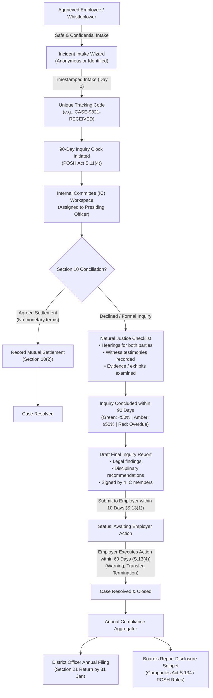

<div align="center">

# ⚖️ SakhiCommittee
### Automated POSH Act (2013) Compliance & Redressal Platform for Indian MSMEs

[](https://react.dev/)
[](https://vitejs.dev/)
[](https://nodejs.org/)
[](https://expressjs.com/)
[](https://www.sqlite.org/)
[](https://tailwindcss.com/)
[](https://legislative.gov.in/)
[](https://opensource.org/licenses/MIT)

**SakhiCommittee** is an enterprise-grade, end-to-end POSH (*Prevention of Sexual Harassment of Women at Workplace Act, 2013*) management and legal redressal platform engineered specifically for Indian MSMEs, startups, and growing enterprises.

It transforms complex, penalty-heavy Indian statutory requirements into an automated, confidential, and bulletproof digital workflow.

---

[Key Differentiators](#-what-makes-sakhicommittee-unique) • [Complete Workflow](#-statutory-workflow-architecture) • [User Roles & Portals](#-role-based-portals--demo-credentials) • [Quick Start](#-quick-start) • [Legal Basis & Penalties](#-legal-basis--penalties-avoided)

</div>

---

## 🌟 What Makes SakhiCommittee Unique?

Most organizations either manage POSH through fragmented email threads, paper binders, generic HR ticketing tools, or expensive legal retainers. Here is how **SakhiCommittee** fundamentally differs from existing alternatives:

| Feature / Capability | Existing HRMS (Darwinbox, GreytHR, Keka) | Govt SHe-Box Portal | Traditional Legal Retainers | **SakhiCommittee Platform** |
| :--- | :---: | :---: | :---: | :---: |
| **Statutory POSH Logic Engine** | ❌ Generic ticket with no statutory awareness | ❌ Static central inbox forwarding to employers | ⚠️ Manual legal advice per case | ✅ **Built-in state machine mapped to POSH Sections 4, 9, 10, 11, 13, 16 & 21** |
| **Anonymous Whistleblower Intake** | ❌ Requires company SSO / employee ID login | ❌ Requires personal Aadhaar / phone verification | ❌ Formal written letter required | ✅ **100% Anonymous Intake** with encrypted tracking code (`CASE-XXXX-RECEIVED`) |
| **Live 90-Day Inquiry Clock** | ❌ No statutory countdown | ❌ Static ticket timestamp | ⚠️ Manual calendar reminders | ✅ **Automated statutory countdown** with dynamic Green ➔ Amber (≥50%) ➔ Red (Overdue) visual alerts |
| **IC Constitution Validation** | ❌ No committee checks | ❌ Not applicable | ⚠️ Manual review by lawyer | ✅ **Dynamic legal validation** enforcing 4+ members, Presiding Officer (senior woman), external NGO/legal advisor, and ≥50% women rule |
| **Small Business (<10 Staff) Handling** | ❌ Forces full enterprise IC setup | ❌ Manual district referral | ⚠️ High consultation fees | ✅ **Automated LCC Exemption Pathway** under Section 4(1) with District Officer liaison and anti-harassment policy drafting |
| **Natural Justice Legal Audit Trail** | ❌ Ad-hoc notes | ❌ None | ⚠️ Paper files | ✅ **Statutory checklist** (Conciliation offered, fair hearings given, evidence reviewed) with timestamped immutable event logs |
| **Document Generation** | ❌ None | ❌ None | ⚠️ Lawyers charge ₹15,000–₹50,000 per draft | ✅ **One-click auto-generation**: Workplace Policy, Appointment Letters, Final Inquiry Reports, Annual Returns, and Board's Report Snippet |
| **Time-Travel Simulation** | ❌ None | ❌ None | ❌ None | ✅ **Built-in Demo Clock Controls** (+10d, +90d, +160d, Reset) for audits, inspections, and presentation demos |

---

## 🏛️ Statutory Workflow Architecture



---

## 👥 Role-Based Portals & Demo Credentials

The platform includes a built-in **Presenter Demo Login Switcher** on the home page — no passwords or signups required.

| Role | Demo Account | Primary Responsibilities & Features |
| :--- | :--- | :--- |
| **MSME Business Owner (Admin)** | `admin@vardhman.com` | • Live **Compliance Health Score (0–100)** with Green/Amber/Red ratings<br/>• **IC Constitution Wizard** with real-time legal validation<br/>• **Awareness Training Logs** tracking periodic employee workshops<br/>• **Annual POSH Report generator** and copyable **Board's Report snippet** |
| **IC Presiding Officer** | `priya@vardhman.com` | • Urgency-sorted case queue (soonest statutory deadline first)<br/>• **Natural Justice Checklist** (Conciliation, hearings, testimonies)<br/>• Immutable inquiry note compiler and audit trail<br/>• **Inquiry Report Compiler** with 4-member legal signature preview |
| **IC Employee Member** | `ananya@vardhman.com` | • Access to active assigned cases, evidence files, and hearing logs |
| **IC External Member (NGO)** | `sunita@vardhman.com` | • Independent external review of inquiry proceedings and legal adherence |
| **District Officer (Govt Authority)** | `district.officer@gov.in` | • SHe-Box Compliance Auditing Authority view<br/>• Read-only inspection of annual returns submitted by district establishments |
| **Aggrieved Party (Public)** | *No login required* | • 3-step anonymous complaint filing<br/>• Confidential public milestone tracking via unique tracking code |

---

## 🏢 Pre-Seeded Demo Company

The application boots automatically with a realistic, validly constituted Indian manufacturing company:

**Vardhman Textiles Ltd.** (18 employees, Ludhiana, Punjab)
- **Internal Committee Constitution:**
  - Mrs. Priya Sharma — Presiding Officer (Female, Senior Employee)
  - Ms. Ananya Sen — Employee Member (Female)
  - Mr. Rajesh Kumar — Employee Member (Male)
  - Dr. Sunita Deshmukh — External Member (Female, NGO & Legal background)
  - *Statutory Ratio: 75% women (≥ 50% threshold ✓) | 4 Members (✓) | Presiding Officer (✓) | External Member (✓)*

### Pre-Seeded Cases Across Legal States:
| Code | Current Stage | Age | Statutory Clock Status | Purpose in Demo |
| :--- | :--- | :---: | :---: | :--- |
| `CASE-9821-RECEIVED` | Received | 2 days | 🟢 **Green** (88 days left) | Demonstrates new intake, legal clock timestamping, and IC acknowledgment |
| `CASE-4390-INQUIRY` | Under Inquiry | 50 days | 🟡 **Amber** (40 days left) | Demonstrates halfway warning zone, conciliation tracking, and hearing logs |
| `CASE-1203-AWAITING` | Awaiting Employer Action | 95 days | 🔴 **Red** (Overdue by 5 days) | Demonstrates completed inquiry past 90 days requiring immediate employer execution |
| `CASE-8841-RESOLVED` | Resolved | 380 days | ✅ **Closed** | Historical case showing completed termination order and inclusion in annual filing |

---

## ⚡ Quick Start

### Prerequisites
- [Node.js](https://nodejs.org/) v18 or higher
- `npm`

### 1. Clone & Install Dependencies

```bash
# Clone the repository
git clone https://github.com/cheetah1306/sakhicommittee-posh.git
cd sakhicommittee-posh

# Install all dependencies (root + backend + frontend)
npm install
npm install --prefix backend
npm install --prefix frontend
```

### 2. Run Locally

```bash
npm run dev
```

This concurrently launches:
- 📡 **Backend API Server**: `http://localhost:5000`
- 💻 **Frontend Web App**: `http://localhost:5173` (or `http://localhost:5174`)

> 💡 **Auto-Seeding**: The SQLite database (`backend/database.sqlite`) initializes and seeds demo data automatically on first launch. No manual migration or database setup is needed.

---

## 🧪 Testing & Code Quality

The codebase enforces strict test coverage and lint standards:

```bash
# Run Vitest test suite
npm test --prefix frontend

# Run Oxlint static analysis
npm run lint --prefix frontend

# Production build verification
npm run build --prefix frontend
```

---

## ⏱️ Interactive Demo Time-Travel

A floating **Demo Clock Controls** widget is available in the bottom-right corner of every screen:
- **`+10 Days`**: Advances simulated system time by 10 days to observe deadline progression.
- **`+90 Days`**: Fast-forwards by 90 days to trigger statutory inquiry deadline breaches, causing case cards to pulse red and alerting the compliance dashboard.
- **`+160 Days`**: Fast-forwards by 160 days to test employer execution expiry.
- **`Reset Demo`**: Instantly wipes mutations and restores the database to its pristine pre-seeded demonstration state.

---

## 📜 Legal Basis & Penalties Avoided

SakhiCommittee helps Indian business owners and HR teams avoid severe statutory consequences under Chapter VI of the POSH Act:

| Section | Statutory Mandate | Penalty for Non-Compliance |
| :--- | :--- | :--- |
| **Section 4(1)** | Mandatory constitution of an Internal Committee (for ≥10 employees) | **₹50,000 fine** for first violation; double fine & cancellation of business license for repeat violations |
| **Section 4(2)** | 50% women members, senior female Presiding Officer, external NGO member | Invalidation of all inquiry proceedings by High Courts / Tribunals due to improper constitution |
| **Section 11(4)** | Formal inquiry must be completed within **90 days** | Legal liability, civil writ petitions, and reputational damage |
| **Section 13(1)** | Inquiry report must be submitted to employer within **10 days** | Procedural lapses leading to inquiry orders being quashed |
| **Section 13(4)** | Employer must implement recommendations within **60 days** | Contempt of statutory obligations and employer liability |
| **Section 16** | Strict confidentiality of complainant, respondent, and witness identities | Fine of **₹5,000** on the employer/violator under POSH Rules |
| **Section 21** | Mandatory annual compliance report to District Officer by **31st January** | Default notices, government inspections, and ROC disclosure audit flags |

---

## 🛠️ Tech Stack

- **Frontend**: React 19, Vite 8, Tailwind CSS v3, Lucide React Icons
- **Backend**: Node.js, Express 4, SQLite3 (`sqlite3` driver with Promise wrappers)
- **Tooling**: Oxlint, Vitest, JSDOM, Concurrently
- **Architectural Design**: State machine-driven case workflows, RESTful API, component-driven UI with printable legal document rendering

---

## 📄 License

This project is licensed under the [MIT License](LICENSE).
